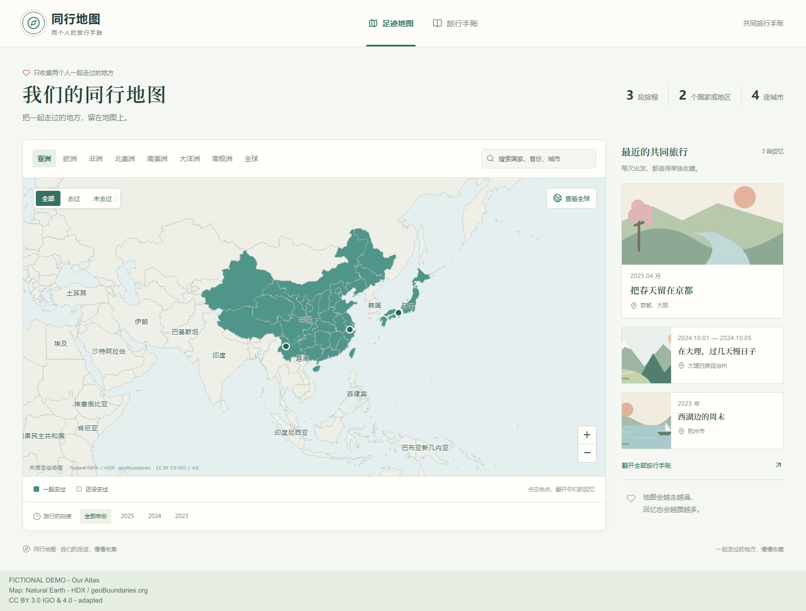
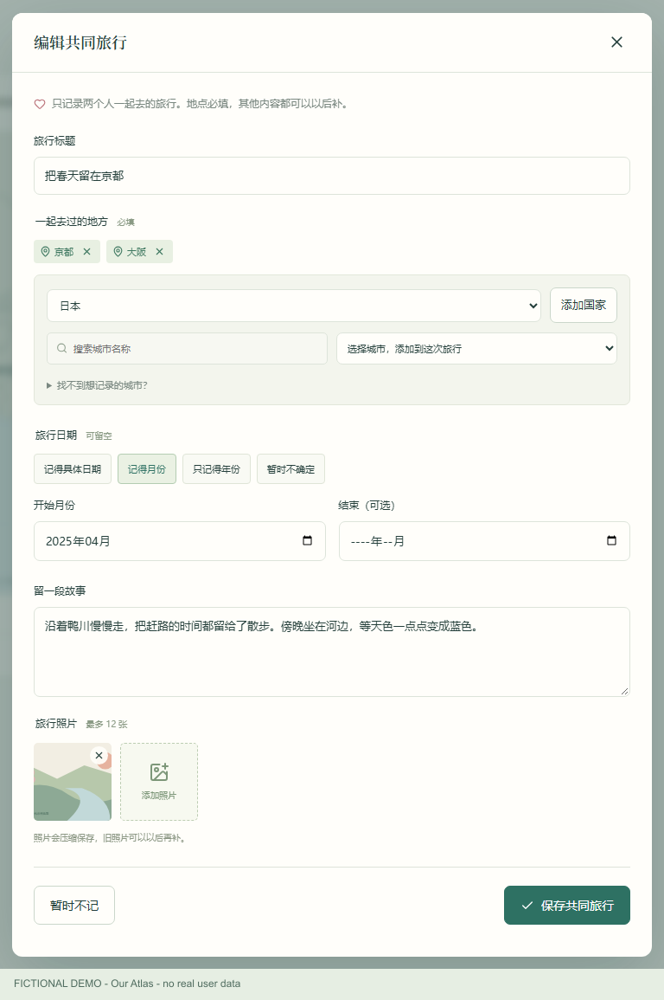
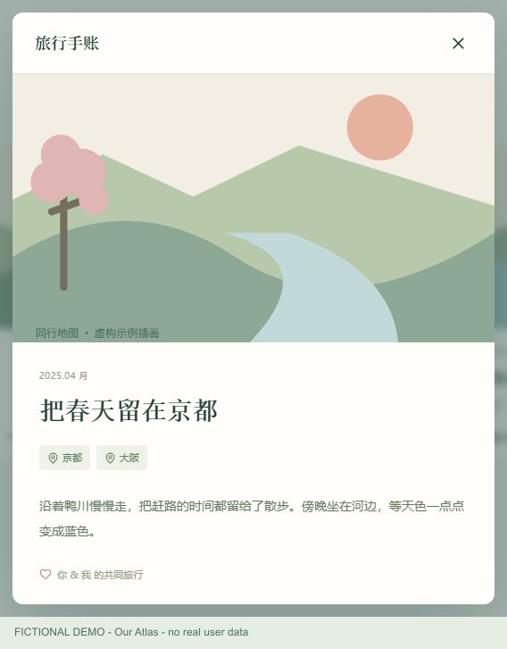
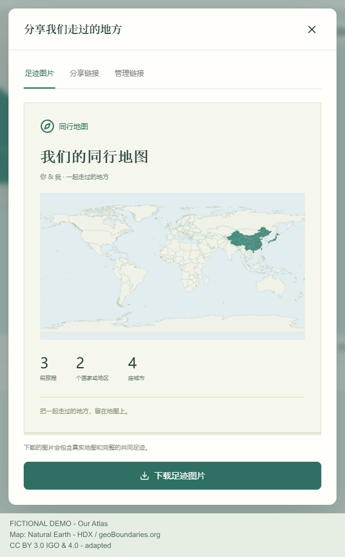

# 日常使用图文指南

本页介绍网站部署完成后的日常记录。还没有自己的站点时，先按 [从零部署教程](deployment.md) 完成安装；网站已经上线、只想更新代码或备份时，阅读 [维护指南](maintenance.md)。

**这里的界面截图全部使用虚构旅行和自制插画。首次部署得到的是空白地图，不会附带这些记录。**

## 1. 先分清浏览地址与编辑地址

| 地址 | 用来做什么 | 需要编辑口令吗 |
| --- | --- | --- |
| 网站首页 `/` | 浏览共同足迹、旅行列表、故事和已保存的照片 | 不需要；保存的内容对访客公开 |
| 网站 `/edit` | 新增、编辑、删除旅行，修改称呼、地图名称和口令 | 需要；两个人共用同一口令 |
| `/share/…` | 浏览某个分享链接选定的旅行 | 取决于链接类型；成员可见时要先验证地图口令 |

已经验证口令，首页仍然只读。需要记录时直接打开收藏的 `/edit` 地址；不要因为首页没有新增按钮而重新初始化网站。

你和伴侣使用同一编辑地址和口令，各自设备验证后即可共同记录。不要把口令放进网址。第一次尚未设图的 `/edit` 会显示初始化表单，按部署教程操作；以后看到的是编辑口令登录。

## 2. 地图与手账分别怎么看

- **按大洲看：** 使用上方大洲标签，或“查看全球”调整视角。
- **找地点：** 在搜索框输入国家、省份或城市名称，点击结果打开地点详情。
- **看不同层级：** 全球支持国家与城市；中国提供省级、地市级区域。点击地点后，在右侧继续查看子地区或相关旅行。
- **按年份回顾：** 使用底部年份按钮，查看对应年份的旅行。日期不确定的记录可以稍后补全。
- **切换去过／未去过：** 使用地图筛选按钮观察地点；是否去过来自已保存旅行，不是一次点击就会永久点亮。
- **看每次旅行：** 切到“旅行手账”，再点开某段回忆查看故事和照片。

同一城市去两次，保存两段旅行即可：手账有两段，城市足迹只计一次。少数较新的行政区只显示城市标记，选择时会提示缺少已核实的边界；自填且没有坐标的城市则暂不显示地图点位，仍会计入文字足迹。

## 3. 记录第一段共同旅行

1. 打开 `/edit`，验证编辑口令。
2. 点击“记录共同旅行”。
3. 填写旅行标题，例如“在大理，过几天慢日子”；也可以先留空，让系统使用地点生成标题。
4. **至少添加一个地点。** 同一次旅行可以包含多个国家、省份或城市，不必为了京都和大阪拆成两段。
5. 按自己记得的程度填写日期，写一点故事，选择照片；这些内容都可以以后补。
6. 点击“保存共同旅行”，等待成功后确认这段旅行出现在手账中。
7. 刷新页面检查记录仍在，再返回首页查看公开效果。

图：这是“编辑共同旅行”的实际表单。新建旅行使用相同字段，开始时没有预填的示例地点、故事和照片。截图中的插画只用于演示。

### 添加地点：选择不等于已经添加

- 下拉选择“中国”是在筛选地点；想把整个国家作为旅行地点，要再点击“添加国家”。
- 选择省份后，可以点“添加省份”，也可以继续选择该省的城市。
- 在城市下拉框选择城市，会把它加入上方地点标签；看到标签才说明已经添加。
- 只记录城市时，不必同时把国家、省份都添加一次，程序会根据城市所属国家计算足迹。
- 同一旅行的重复地点不会反复加入；不需要的地点可用标签旁的叉号移除。
- 找不到城市时，展开“找不到想记录的城市？”，输入名称并添加。自填城市没有自动地理编码，暂不显示地图点位。

### 日期：只填记得的精度

| 选项 | 适合的情况 | 例子 |
| --- | --- | --- |
| 记得具体日期 | 知道确切哪一天或起止日期 | `2024-10-01` 到 `2024-10-05` |
| 记得月份 | 只确定某年某月 | `2025-04` |
| 只记得年份 | 补录较久以前的旅行 | `2023` |
| 暂时不确定 | 先留下地点，回头再补 | 日期留空 |

结束日期可不填；填写时不能早于开始日期。**切换日期精度会清空原有起止值**，请选定精度后重新填写，不必为了提交编造精确日期。

### 照片与故事

- 故事是可选文字，可以先写一顿饭、一段路或一句记得的话，以后再编辑。
- 每段旅行最多 12 张照片，网页支持 JPG、PNG、WebP，可选择 20 MB 以内的原图。
- 网页会先压缩，通常把最长边缩到不超过 1600 像素；服务端继续检查和重编码，收到的单张文件须在 4 MiB 以内。压缩后仍超限时请选择较小图片。
- 新上传的图片会清除 EXIF/GPS 等元数据；历史照片不会被自动重写。程序不会自动给画面中的人脸或文字打码，保存前确认内容适合公开。
- 保存的是压缩后的副本，重要原图另行保存，不要把网站当成原片仓库。

## 4. 修改或删除已经保存的旅行

点开旅行详情，在已登录的 `/edit` 中点击“编辑这段回忆”，修改后再次保存。首页和只读分享页没有编辑入口。

删除时按页面要求确认。某城市还有其他到访记录时，删除一段旅行不会让它从全部足迹中消失；删除最后一段才会移除对应到访。

删除旅行记录不等于清空 Storage 中的原始对象；需要清理存储或恢复数据时，先按维护指南备份并核对关联，不直接批量删除照片桶。

## 5. 分享图片或只读链接

在 `/edit` 点击“分享足迹”，选择对应页签。

| 方式 | 操作 | 接收方看到什么 |
| --- | --- | --- |
| 足迹图片 | 在“足迹图片”中点击下载 | PNG 中的地图、称呼和足迹统计，不是可恢复的数据文件 |
| 分享链接 | 选择整张地图或选定旅行，再选择查看范围和有效期 | 这个链接包含的旅行详情 |
| 管理链接 | 查看现有链接，关闭不再使用的链接 | 关闭后的原链接失效 |

链接默认 7 天，可选 1 天、30 天或一直有效。选择“有链接的人可查看”时无需登录；选择“只允许已打开这张地图的成员查看”时，接收方应先在 `/edit` 验证共同口令。

**分享范围、过期和关闭只影响该链接，不会隐藏首页已经公开的旅行和照片。** 下载出去的图片也不能远程撤回。希望只公开部分旅行时，应先调整产品的访问模型，不能把某条分享链接当成全站隐私开关。

## 6. 地图设置与共同口令

- 在 `/edit` 点击“地图设置”，可以修改地图名称和两人的称呼。
- 展开口令设置可修改共同口令；新口令长度为 12～128 字符，两次输入需一致。
- 修改后其他设备需要重新验证；请把新口令单独告诉伴侣。
- 当前没有自动邮件找回。仍有设备登录时可从设置修改；全部退出后的恢复流程见 [维护指南](maintenance.md)。不需要删掉旅行重新建图。

## 7. 日常记录、代码更新与备份的区别

| 你想做什么 | 在哪里做 | 需要重新部署吗 |
| --- | --- | --- |
| 加旅行、改故事、管理照片 | 网站 `/edit` | 不需要 |
| 改页面、地图交互或接口代码 | VS Code → GitHub → 已连接的 Vercel | 需要发布代码 |
| 改服务器密钥或其他环境配置 | Vercel 项目设置 | 需要重新部署使配置生效 |
| 备份旅行和照片 | Supabase 数据库与 Storage，分别备份 | 备份本身不需要 |

源码 ZIP 和 Git 历史只保存程序，不保存 Supabase 中的真实记录和照片。完整备份方法见 [维护指南的备份与恢复](maintenance.md#备份与恢复)。
